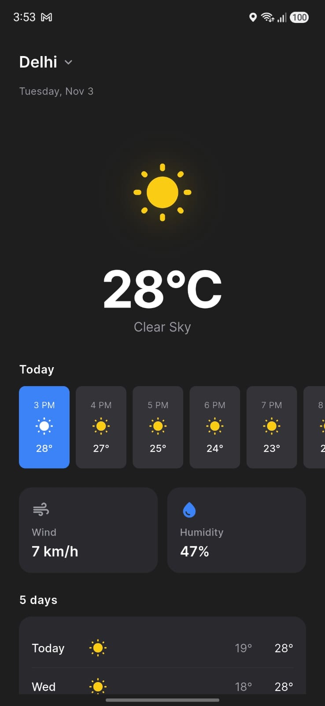
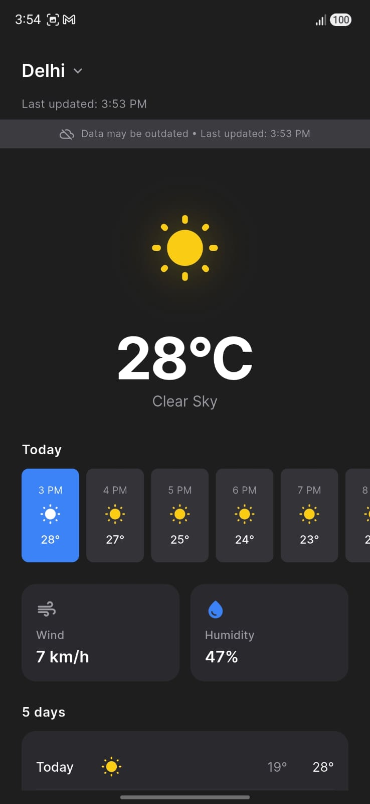

# ClimateScope 🌦️

A clean, modern, dark-themed weather application built with Flutter as a take-home assessment for a Mobile Application Developer Internship. ClimateScope delivers real-time weather forecasts, hourly projections, multi-city geocoding, and resilient offline caching using the free Open-Meteo API.

---

## 📱 App Screenshots

| Main Weather View | City Search & Disambiguation |
| :---: | :---: |
|  |  |
| *Radial weather glow, oversized temperature, 24h strip, metrics & 5-day forecast* | *Real-time geocoding with name, state/region, and country disambiguation* |

| Offline Mode with Stale Banner | Error & Recovery State |
| :---: | :---: |
|  |  |
| *Cached forecast persistence with prominent staleness banner* | *User-friendly failure message mapping with one-tap retry action* |

---

## 🛠️ Technology Stack & Versions

ClimateScope is built on modern, production-grade Flutter and Dart tooling:

| Technology / Component | Version | Description & Role |
|---|---|---|
| **Flutter SDK** | `3.47.9+` (Channel stable, min `3.38.0`) | Cross-platform UI toolkit and runtime |
| **Dart SDK** | `3.13.7` (min `^3.13.7 <4.0.0`) | Sound null-safe, strictly typed language |
| **Target Platforms** | Android (API 24+ / Nougat to Android 14+), iOS (15.0+) | Primary mobile targets |
| **Recommended IDE** | Android Studio Ladybug / Koala or VS Code | Development environment with Flutter/Dart plugins |
| **State Management** | `flutter_riverpod: ^2.6.1` | Reactive MVVM state management via `AsyncNotifier` (no code generation) |
| **Networking** | `dio: ^5.8.0+1` (v5.11.1) | Robust HTTP client with timeouts, interceptors, and `CancelToken` |
| **Local Persistence** | `shared_preferences: ^2.2.2` | Key-value disk persistence for cached weather and preferences |
| **Localization & Time** | `intl: ^0.20.2` (v0.20.3) | Timezone-aware date, day-of-week, and timestamp formatting |
| **Iconography & Design** | `cupertino_icons: ^1.0.8` | Adaptive icon assets and typography tokens |
| **Typography** | Inter (Weights 400, 500, 600, 700) | Bundled clean sans-serif font family |
| **Linting & Quality** | `flutter_lints: ^6.0.0` | Official Flutter static analysis and linting guidelines |

---

## 🚀 Setup & Run Instructions

Follow these steps to run ClimateScope on your local development machine:

### Prerequisites
- [Flutter SDK](https://docs.flutter.dev/get-started/install) (`3.47.x` or compatible Flutter 3.x) installed and added to your `PATH`.
- **Android Studio** (with Android SDK platform API 24+, emulator or connected device) OR **Xcode** (15+, for macOS/iOS development).
- **Git** command-line tools.

### Step-by-Step Guide

1. **Clone the repository:**
   ```bash
   git clone https://github.com/your-username/ClimateScope.git
   cd ClimateScope
   ```

2. **Verify your Flutter installation:**
   ```bash
   flutter doctor
   ```

3. **Install project dependencies:**
   ```bash
   flutter pub get
   ```

4. **Run the automated test suite (42 unit and widget tests):**
   ```bash
   flutter test
   ```

5. **Launch the application:**
   - Launch your preferred Android Emulator, iOS Simulator, or connect a physical device via USB.
   - Run the app via the command line:
     ```bash
     flutter run
     ```
   - Alternatively, open the project in **VS Code** or **Android Studio** and press `F5` / click **Run**.

> [!NOTE]
> **Zero API Keys Required:** ClimateScope queries the public Open-Meteo REST endpoints directly. No registration, credentials, or `.env` configuration are needed.

---

## ✨ Features Completed (Phases 0–7)

### Core Features (Completed)

- [x] **Real-Time City Search & Geocoding:**
  - Fast search powered by the Open-Meteo Geocoding API (`/v1/search`).
  - 500ms debounce to minimize unnecessary network traffic while typing.
  - Comprehensive input validation that intercepts empty queries, whitespace-only inputs, and strings consisting solely of special characters before making network calls.
  - Seamless handling of the Open-Meteo edge case where the `results` key is completely omitted when no matches exist.

- [x] **Multi-City Disambiguation:**
  - Displays matches in a clean list specifying `Name`, `Admin Region (State/Province)`, and `Country` (e.g., *London, England, United Kingdom* vs. *London, Ontario, Canada*).
  - Tapping a result immediately closes the modal sheet and fetches weather for the exact coordinates.

- [x] **Current Weather Hero Display:**
  - Prominent current temperature with explicit unit symbol (`°C` / `°F`) wrapped in a responsive `FittedBox`.
  - Condition-specific radial backlight glow (`WeatherIconGlow`) tailored to weather categories (warm solar glow for clear skies, cyan glow for showers, deep violet/amber for thunderstorms).
  - Dynamic weather condition label and high-contrast Material symbol.

- [x] **Hourly Forecast Strip (~24 Hours):**
  - Horizontal scrolling `ListView.separated` presenting the next 24 consecutive hours.
  - Automatically highlights the current hour on initial load.
  - Smooth 200ms `AnimatedContainer` visual feedback when selecting different hourly slots.

- [x] **Key Meteorological Metrics:**
  - Side-by-side surface cards displaying **Wind Speed** (`km/h` or `mph`) and **Relative Humidity** (`%`).
  - Accessible layout with semantic labels for assistive technologies.

- [x] **5-Day Daily Forecast:**
  - Card-styled container displaying 5 future days separated by subtle dividers.
  - Formatted day names (`Mon`, `Tue`, etc.), weather condition icons, and min/max temperature ranges.

- [x] **WMO Weather Code Mapping Engine:**
  - Centralized pure mapper (`WeatherCodeMapper`) supporting all 21 WMO weather interpretation codes (0–99).
  - Categorizes clear sky, partly cloudy, fog, drizzle, rain, snow, showers, and thunderstorms.
  - Safe fallback for undocumented codes (`help_outline_rounded` in neutral grey).

- [x] **Offline Caching & Staleness Indicator:**
  - Automatically caches the latest successfully fetched weather snapshot to `SharedPreferences` in JSON format.
  - Embedded schema versioning (`cache_version: 1`) that automatically invalidates and purges outdated schemas or corrupted payloads without crashing.
  - Intelligently distinguishes **Offline + Cache** (renders data with a full-bleed amber staleness banner and "Last updated" timestamp) from **Offline + No Cache** (renders full-page error view with retry action).

- [x] **Comprehensive UI State Management:**
  - First-launch empty state inviting user interaction.
  - Centered accent blue loading indicator during data fetches.
  - Dedicated search sheet states (initial prompt, active searching spinner, no results found view).
  - User-friendly error screens mapping typed exceptions to actionable instructions with a working **Retry** button.

- [x] **In-Flight Request Cancellation:**
  - Dio `CancelToken` integrated into both `SearchNotifier` and `WeatherNotifier`.
  - Rapidly typing or searching a different city automatically cancels pending HTTP requests to prevent race conditions and obsolete UI overwrites.

- [x] **Pure Unit Conversion Utility:**
  - Isolated pure utility (`UnitConverter`) handling Celsius ↔ Fahrenheit and km/h ↔ mph math, formatting, and rounding.

- [x] **Dark Design System & Accessibility:**
  - Strict token-driven design system (`AppColors`, `AppTypography`, `AppDimensions`, `AppTheme`).
  - Custom Inter typography hierarchy.
  - WCAG AAA/AA compliant contrast ratios across dark surfaces (`#121212`, `#1E1E1E`, `#2A2A2A`).
  - `Semantics` tags attached to icons, buttons, headers, and metric cards for screen readers.

### Bonus Features Status
- [x] **Dark Mode by Design:** Built from the ground up with a cohesive dark aesthetic; light mode was intentionally excluded per design specifications to maximize battery efficiency and visual contrast.
- [x] **Unit Conversion Architecture Ready:** `SettingsNotifier` with `SharedPreferences` unit persistence and full conversion math (`UnitConverter`) are implemented and test-covered.
- [x] **Comprehensive Automated Test Suite:** 42/42 tests passing across unit, repository, mapper, and widget layers.
- [ ] *Pull-to-refresh (Phase 8a)*, *Unit toggle UI switch (Phase 8b)*, *Recent search history chips (Phase 8c)*, and *GPS location (Phase 8d)* were scoped as cuttable bonus phases.

---

## 🏗️ Architecture & Design Pattern

ClimateScope follows a **Feature-First Layered MVVM (Model-View-ViewModel)** architectural pattern, powered by **Riverpod** for reactive state management and dependency injection.

### Architecture Overview

```
lib/
├── core/                               # Cross-cutting foundational modules
│   ├── constants/                      # API endpoints, cache keys, debounce intervals
│   ├── strings/                        # Centralized user-facing strings (AppStrings)
│   ├── theme/                          # Colors, typography, spacing, ThemeData
│   └── utils/                          # Pure utilities (WeatherCodeMapper, UnitConverter)
└── features/
    └── weather/
        ├── domain/                     # Pure Dart models, enums, typed failure objects
        │   ├── enums/                  # TemperatureUnit, WeatherCondition
        │   ├── failures/               # Sealed WeatherFailure hierarchy
        │   └── models/                 # CityModel, CurrentWeather, Daily, Hourly, WeatherData
        ├── data/                       # Networking and local storage implementations
        │   ├── api/                    # Dio clients: GeocodingApiClient, WeatherApiClient
        │   ├── local/                  # WeatherLocalStorage (SharedPreferences wrapper)
        │   └── repositories/           # WeatherRepository (bridges data & domain)
        ├── application/                # Riverpod Notifiers & ViewModels
        │   ├── weather_notifier.dart   # AsyncNotifier<WeatherDataModel?>
        │   ├── search_notifier.dart    # AsyncNotifier<List<CityModel>>
        │   ├── settings_notifier.dart  # Notifier<TemperatureUnit>
        │   └── providers.dart          # Dependency injection container
        └── presentation/               # Declarative UI layer
            ├── screens/                # WeatherScreen (CustomScrollView container)
            ├── widgets/                # WeatherHero, HourlyStrip, MetricCards, etc.
            └── sheets/                 # SearchBottomSheet, SearchField, SearchResultTile
```

### Layer Responsibilities

```
┌─────────────────────────────────────────────────────────────┐
│                     Presentation Layer                      │
│   ConsumerWidgets, screens, modal sheets, and components    │
│   • Consumes state via ref.watch() / triggers via ref.read()│
│   • Strictly no business logic, no raw hex values           │
├─────────────────────────────────────────────────────────────┤
│                     Application Layer                       │
│   Riverpod ViewModels (AsyncNotifier / Notifier)            │
│   • Manages UI state using AsyncValue<T>                    │
│   • Handles debounce, request cancellation, and cache sync  │
├─────────────────────────────────────────────────────────────┤
│                       Domain Layer                          │
│   Pure Dart business logic, models, enums, sealed failures  │
│   • Immutable models with strict null safety                │
│   • WeatherCodeMapper and UnitConverter pure functions      │
├─────────────────────────────────────────────────────────────┤
│                        Data Layer                           │
│   Data sources, HTTP network clients, local disk cache      │
│   • Dio HTTP clients with timeouts and CancelTokens         │
│   • WeatherRepository mapping DioException → WeatherFailure │
│   • WeatherLocalStorage with schema version verification    │
└─────────────────────────────────────────────────────────────┘
```

### Why Riverpod with AsyncNotifier?
- **Built-in `AsyncValue<T>`:** Automatically represents `loading`, `error`, and `data` states without requiring manual boilerplate state classes or cumbersome event unions.
- **Compile-Time Safety:** Unlike traditional `Provider`, Riverpod eliminates `ProviderNotFoundException` by catching dependency errors at compile time.
- **Decoupled from `BuildContext`:** Notifiers are testable in isolation without mocking the Flutter widget tree.
- **Superior to BLoC for This Scope:** BLoC introduces substantial event/state ceremony and code generation overhead for two primary async streams; Riverpod provides identical architectural rigor with significantly greater clarity and lower overhead.

---

## 📚 Libraries & Justification

| Library | Version | Justification |
|---|---|---|
| **`flutter_riverpod`** | `^2.6.1` | Modern reactive state management; native `AsyncValue` handling, no `BuildContext` coupling, clean unit testability. No code generation required. |
| **`dio`** | `^5.8.0+1` | Advanced HTTP client superior to basic `http`; provides granular connection/receive timeouts, interceptor hooks, and native `CancelToken` support. |
| **`shared_preferences`** | `^2.2.2` | Lightweight, battle-tested persistent key-value storage ideal for caching serialized JSON weather payloads and user preferences across app reboots. |
| **`intl`** | `^0.20.2` | Standard Dart date and time formatting utility; handles dynamic weekday formatting and timestamp displays. |
| **`flutter_lints`** | `^6.0.0` | Enforces idiomatic Flutter styling, const constructor usage, and code safety standards. |

---

## 🧪 Automated Testing

ClimateScope includes an extensive test suite verifying business logic, error mappings, utilities, and widget rendering.

```bash
flutter test
```

### Test Suite Highlights (42 Tests Passing)
- **UnitConverter Tests (13 tests):** Validates Celsius ↔ Fahrenheit, km/h ↔ mph conversions, boundary values (0°C, 100°C, -40°C), rounding, and unit label attachments.
- **WeatherCodeMapper Tests (5 tests):** Validates WMO code translations, condition strings, tint colors, glow parameters, and unknown code fallbacks.
- **Cache & Storage Tests (3 tests):** Validates JSON serialization/deserialization, schema version mismatch protection, and graceful recovery from corrupt payloads.
- **Error Mapping Tests (4 tests):** Validates transformation of network drops, timeouts, and missing endpoints into user-friendly `WeatherFailure` types.
- **Widget & Component Tests (17 tests):** Smoke tests, `LoadingState`, `EmptyState`, `ErrorState`, `OfflineBanner`, `WeatherHero`, `WeatherIconGlow`, `HourlySlot` selection animations, `HourlyStrip` filtering, `MetricCardsRow`, `DailyForecastList`, and `WeatherHeader`.

---

## ⚠️ Assumptions, Known Limitations & Edge Cases

### Assumptions Made
1. **Open-Meteo Availability:** The application relies on the free Open-Meteo API. While reliable and keyless, it has no commercial SLA and may occasionally experience rate throttling under abnormal traffic.
2. **Single-City Active Cache:** The app caches the weather forecast for the most recently inspected city. Opening the app offline displays this city's weather rather than an entire multi-city catalog.
3. **Timezone Alignment:** Hourly forecasts are aligned to the local timezone returned by the Open-Meteo API (`timezone=auto`).

### Known Limitations
1. **Single Saved City:** Multiple bookmarked cities or favorite city carousels are not currently supported; searching a new city replaces the active view.
2. **No Real-Time OS Network Listener:** Connectivity status is determined upon API request resolution rather than continuously streaming via a background network daemon.
3. **Unit Switcher UI:** While `UnitConverter` and `SettingsNotifier` are fully functional and tested, a dedicated UI switch on the screen was scoped for Phase 8b.

### Critical Edge Cases Handled
- **Omitted `results` key:** Open-Meteo returns `{ "generationtime_ms": ... }` with no `results` property when no geocoding match is found; our parser handles this safely without null pointer exceptions.
- **In-flight request race conditions:** Typing a new query immediately cancels previous active HTTP calls via `CancelToken`.
- **Corrupted cache resilience:** Malformed cache payloads are detected, purged from storage, and gracefully transitioned to an empty state.
- **Orientation changes:** State is retained across screen rotations without resetting searches or cached views.

---

## 🔮 Future Improvements & Roadmap (With More Time)

If allocated additional development time, the following enhancements would be prioritized:

1. **Complete Bonus Phases (8a–8d):**
   - **Pull-to-Refresh:** Integrate `RefreshIndicator` for pull-down forecast updates.
   - **Interactive Unit Switcher:** Header toggle for seamless 1-tap switching between Metric (°C, km/h) and Imperial (°F, mph).
   - **Recent Searches:** Persistent chip list of recent cities in the search bottom sheet with a "Clear all" option.
   - **Current Location (GPS):** Automatic weather lookup based on device location using `geolocator` with runtime permission flows.
2. **Interactive Weather Charts:**
   - 24-hour interactive bezier temperature and precipitation probability curve charts.
3. **Animated Weather Backdrops:**
   - Subtle particle effects (drifting snow, rain drops, moving cloud gradients) reacting to the current WMO code.
4. **Multi-City Saved Watchlist:**
   - Horizontal page view or drawer allowing users to swipe between saved locations (e.g., London, Tokyo, San Francisco).
5. **Weather Alerts & Notifications:**
   - Integration with severe weather alert endpoints and local background refresh using WorkManager.

---

## 👨‍💻 Author & Acknowledgments

- **Author:** Candidate for Mobile Application Developer Internship
- **Weather Data Provider:** [Open-Meteo API](https://open-meteo.com/) (Free weather API for non-commercial use)
- **Font:** [Inter](https://rsms.me/inter/) by Rasmus Andersson
