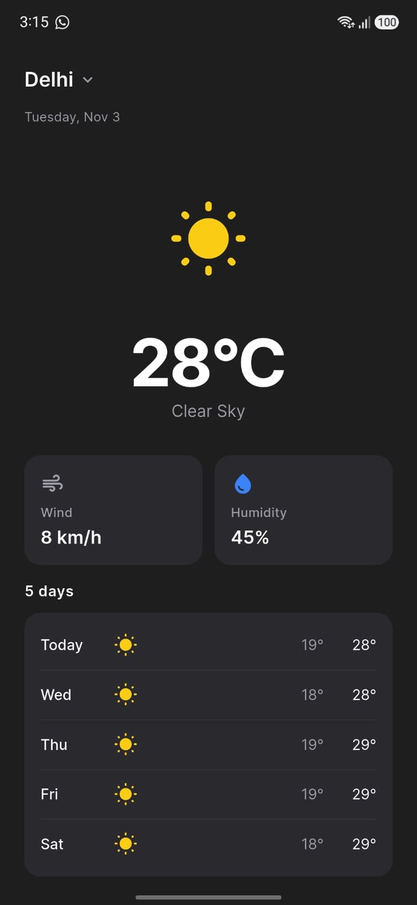
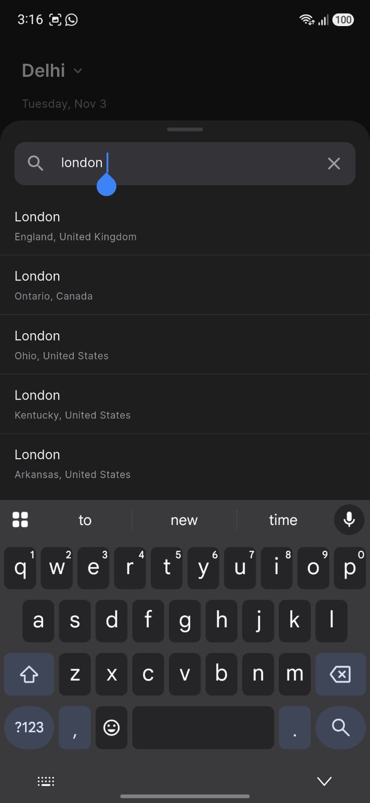
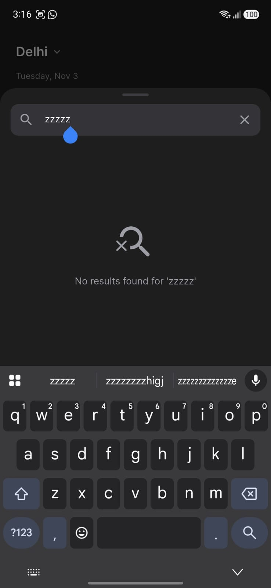
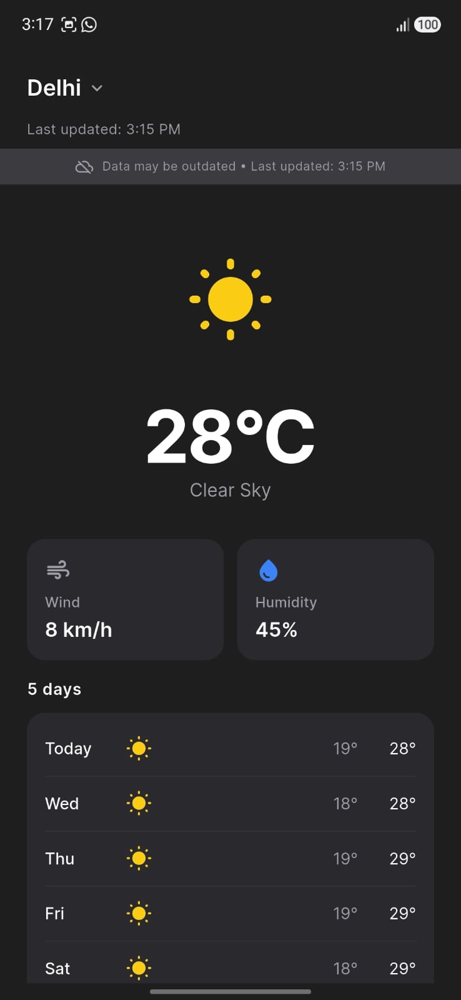

AI INSTRUCTION: Read ALL project docs (PRD, Architecture, Design, Rules, Phases) before writing any code.

# ClimateScope 🌦️

A clean, dark-themed weather app built with Flutter as a Mobile Application Developer Internship take-home project.

## Tech Stack

| Technology | Version | Purpose |
|---|---|---|
| Flutter | 3.47.9 | UI framework |
| Dart | 3.13.7 | Language |
| flutter_riverpod | {version} | State management (AsyncNotifier, no codegen) |
| dio | {version} | HTTP client with timeouts and cancellation |
| shared_preferences | {version} | Local persistence (cache, settings, history) |
| intl | {version} | Date and time formatting |
| geolocator | {version} | Device location (bonus feature) |

## Setup & Run

### Prerequisites

- Flutter 3.47.9+ installed
- Android SDK (API 24+) or Xcode (iOS 15.0+)
- An emulator or physical device

### Steps

```bash
git clone {repo-url}
cd climate_scope
flutter pub get
flutter run
```

## Features

### Must-Have

- [ ] City search with input validation
- [ ] Multi-city disambiguation (name + region + country)
- [ ] Current weather: temperature, humidity, wind speed with units
- [ ] 5-day forecast with daily min/max
- [ ] Hourly forecast (next ~24 hours)
- [ ] WMO weather code mapping with icons
- [ ] Loading, error, and empty states
- [ ] Offline support with cached data and staleness indicator
- [ ] Dark theme with design system

### Bonus

- [ ] Pull-to-refresh
- [ ] Metric/Imperial unit toggle
- [ ] Search history (persisted, clearable)
- [ ] Current location with permission handling
- [x] Dark mode (by design — app is dark-only; system theme switching is intentionally not implemented)

### Not Included

- ❌ Unit tests (skipped due to time constraints; architecture supports testability via DI and pure mappers)
- ❌ Light theme (dark-only by design requirement)

## Architecture

Feature-first layered MVVM with Riverpod. See [Architecture.md](Architecture.md) for details.

```
lib/
├── core/          # Theme, constants, strings, utilities
├── features/
│   └── weather/
│       ├── data/          # API clients, repository, local storage
│       ├── domain/        # Models, enums, failures
│       ├── application/   # Riverpod notifiers and providers
│       └── presentation/  # Widgets, screens, sheets
```

## Libraries & Justification

| Library | Why This Library |
|---|---|
| flutter_riverpod | Built-in AsyncValue for loading/error/data states, compile-time safe, no BuildContext in notifiers |
| dio | Superior to http: interceptors, cancel tokens, configurable timeouts |
| shared_preferences | Simple key-value storage, sufficient for caching one weather result + settings |
| intl | Standard Dart date/time formatting |
| geolocator | Well-maintained, handles permission flows on both platforms |

## Multi-City Disambiguation

When a city name matches multiple locations, all results are shown in a list with:

- City name
- Admin1 (state/province/region)
- Country

Example: searching "London" shows London (England, United Kingdom), London (Ontario, Canada), etc.

## Assumptions & Known Limitations

- {To be filled}
- Open-Meteo API is free and requires no API key, but has no SLA
- Cache stores only the last searched city's data
- Hourly forecast starts from the current hour in the city's timezone

## What I'd Improve

- {To be filled with reflections}
- Add unit tests and widget tests
- Add a light theme option
- Support multiple saved cities
- Add weather notifications
- Implement a weekly chart view

## Screenshots

| Screen | Description |
|---|---|
|  | Main weather view |
|  | City search sheet |
|  | Error state |
|  | Offline with cached data |
